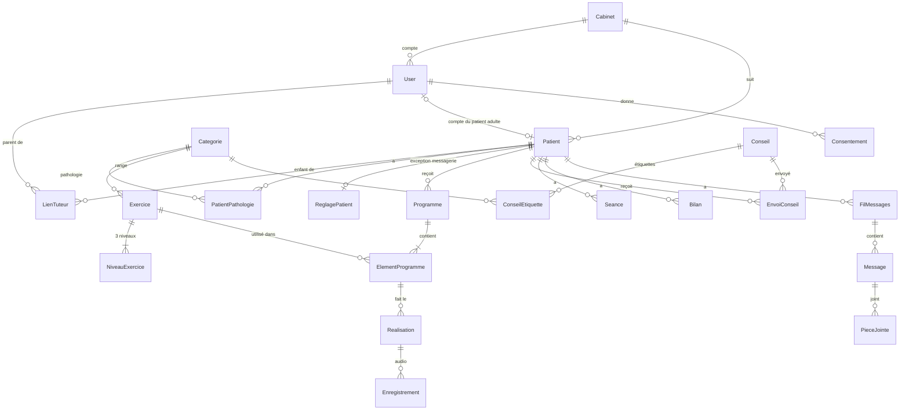

# Base de données

Le schéma technique est dans `packages/db/prisma/schema.prisma`. Cette page l'explique en mots simples.

## Vue d'ensemble

`JournalAcces` n'est relié à rien, exprès : voir plus bas.

## Les tables

### Cabinet et comptes

| Table                    | Ce qu'elle contient                                                                                                                                                                 |
| ------------------------ | ----------------------------------------------------------------------------------------------------------------------------------------------------------------------------------- |
| **Cabinet**              | Le cabinet (nom) et le grand interrupteur « messagerie activée oui/non ».                                                                                                           |
| **User** (`utilisateur`) | Un compte : e-mail, mot de passe **haché** (jamais en clair), rôle (`ORTHO`, `PARENT` ou `PATIENT_ADULT`), cabinet.                                                                 |
| **LienTuteur**           | « Ce parent est responsable de cet enfant ». Un enfant peut avoir plusieurs parents, un parent plusieurs enfants. C'est ce lien qui décidera de ce qu'un parent a le droit de voir. |
| **Consentement**         | Qui a accepté quoi (conditions, données de santé, messagerie, audio), avec quelle version du texte, quand, et s'il l'a retiré (avec la date du retrait).                            |

### Connexion (voir [AUTHENTIFICATION.md](./AUTHENTIFICATION.md))

| Table                  | Ce qu'elle contient                                                                                                    |
| ---------------------- | ---------------------------------------------------------------------------------------------------------------------- |
| **Session**            | Une session ouverte (web, ou jeton mobile). Seule l'**empreinte** du jeton est stockée, avec expiration et révocation. |
| **Invitation**         | Lien d'invitation d'un parent ou d'un patient : e-mail, rôle, expiration, date d'utilisation (usage unique).           |
| **TentativeConnexion** | Tentatives comptées pour limiter les essais. Clé = empreinte (jamais l'e-mail ou l'IP en clair).                       |

### Patients

| Table                 | Ce qu'elle contient                                                                                                                                                    |
| --------------------- | ---------------------------------------------------------------------------------------------------------------------------------------------------------------------- |
| **Patient**           | Prénom, date de naissance, notes, cabinet. Un patient adulte a en plus un lien vers **son propre compte** ; un enfant n'en a pas (il utilise le compte de son parent). |
| **PatientPathologie** | Les pathologies du patient (lien vers les catégories). Un patient peut en avoir plusieurs.                                                                             |
| **ReglagePatient**    | Exception à la messagerie du cabinet pour un patient : `oui`, `non`, ou vide = suit le cabinet.                                                                        |

**Règle messagerie** : activée pour un patient = réglage du patient s'il existe, sinon réglage du cabinet.

### Bibliothèque

| Table              | Ce qu'elle contient                                                                                                                                                              |
| ------------------ | -------------------------------------------------------------------------------------------------------------------------------------------------------------------------------- |
| **Categorie**      | Une pathologie (Langage écrit, Bégaiement, Voix…). Sert à ranger les exercices, à décrire les patients et à étiqueter les conseils.                                              |
| **Exercice**       | Titre, description, âge min/max, durée, matériel, et l'**aperçu** (image + consigne courte) visible sans ouvrir la fiche. Un exercice est commun à tous, ou propre à un cabinet. |
| **NiveauExercice** | Les 3 niveaux d'un exercice (1, 2, 3), chacun avec sa consigne. La base refuse un niveau 0 ou 4, ou deux fois le même niveau.                                                    |

### Programme et suivi à la maison

| Table                | Ce qu'elle contient                                                                                                                                      |
| -------------------- | -------------------------------------------------------------------------------------------------------------------------------------------------------- |
| **Programme**        | Le programme d'exercices d'un patient (titre, dates, actif ou non, auteur).                                                                              |
| **ElementProgramme** | Une ligne du programme : quel exercice, quel niveau (1 à 3), combien de fois par semaine (1 à 7), quels jours, et le mot pour la famille.                |
| **Realisation**      | Une fois où l'exercice a été fait (ou non) : date, fait oui/non, ressenti (facile, moyen, difficile), score (0 à 100).                                   |
| **Enregistrement**   | Un fichier audio lié à une réalisation. La base ne garde que la **référence** du fichier, pas le fichier lui-même (il sera stocké chez l'hébergeur HDS). |

### Conseils

| Table                | Ce qu'elle contient                                                                                                                                                |
| -------------------- | ------------------------------------------------------------------------------------------------------------------------------------------------------------------ |
| **Conseil**          | Soit un **modèle pré-fait** (avec tranche d'âge et étiquettes de pathologie), soit un **conseil personnalisé** pour un patient, éventuellement adapté d'un modèle. |
| **ConseilEtiquette** | Les pathologies auxquelles un modèle de conseil s'applique.                                                                                                        |
| **EnvoiConseil**     | Un conseil envoyé à un patient : quand, à quelle fréquence le rappeler, et quand la famille l'a lu.                                                                |

### Séances et bilans

| Table      | Ce qu'elle contient                                                                                               |
| ---------- | ----------------------------------------------------------------------------------------------------------------- |
| **Seance** | Date, objectifs, matériel, notes.                                                                                 |
| **Bilan**  | Type (initial, évolution, renouvellement, fin de prise en charge), contenu, statut (brouillon, finalisé, envoyé). |

### Messagerie

| Table           | Ce qu'elle contient                                               |
| --------------- | ----------------------------------------------------------------- |
| **FilMessages** | Une conversation à propos d'un patient.                           |
| **Message**     | Un message du fil : auteur, texte, date d'envoi, date de lecture. |
| **PieceJointe** | Un fichier joint à un message (référence du fichier uniquement).  |

### Traçabilité

| Table            | Ce qu'elle contient                                                                  |
| ---------------- | ------------------------------------------------------------------------------------ |
| **JournalAcces** | Qui a consulté quel dossier patient, quand, et quelle partie. Aucun contenu médical. |

## Que se passe-t-il quand on supprime ?

- **Un patient** : tout ce qui le concerne disparaît : programmes, lignes de programme, réalisations, enregistrements, séances, bilans, conseils personnalisés et envois, conversations, messages, pièces jointes, liens avec ses parents, pathologies, réglage.
- **Deux exceptions, conservées après la suppression d'un patient** :
  - le **journal d'accès** (il n'a volontairement aucun lien technique avec les autres tables) ;
  - les **preuves de consentement** (le lien vers le patient est vidé, la preuve reste rattachée au compte qui a consenti).
- **Un parent** : ses liens tuteurs disparaissent ; l'enfant et son dossier restent.
- **Le compte d'un patient adulte** : le dossier reste, il n'est simplement plus relié à un compte.
- **Un orthophoniste** : ses séances, bilans et programmes restent (l'auteur devient « inconnu »).
- **Interdit tant qu'ils sont utilisés** : supprimer un cabinet qui a des patients ou des comptes, une catégorie utilisée, ou un exercice présent dans un programme.

## Données fictives (seed)

`pnpm db:seed` vide la base puis crée :

- 1 cabinet fictif (messagerie activée) et 1 orthophoniste ;
- 3 patients : **Léa, 7 ans** (1 parent), **Tom, 9 ans** (2 parents), **Paul, adulte** avec son propre compte (messagerie désactivée pour lui) ;
- 7 catégories, 9 exercices à 3 niveaux, 4 modèles de conseil ;
- 2 programmes (Léa et Tom) et leurs réalisations sur les **6 dernières semaines** ;
- quelques séances, bilans, consentements, messages et entrées du journal d'accès.

Tous les comptes ont des e-mails en `@exemple.test` (domaine réservé, jamais réel) et le mot de passe défini par `SEED_PASSWORD` dans `.env`. Le seed refuse de tourner si `NODE_ENV=production`.

## Commandes

| Commande                       | Effet                                                                                                                                                                                                                |
| ------------------------------ | -------------------------------------------------------------------------------------------------------------------------------------------------------------------------------------------------------------------- |
| `pnpm db:up`                   | Démarre PostgreSQL (Docker).                                                                                                                                                                                         |
| `pnpm db:migrate`              | Applique les migrations (crée les tables).                                                                                                                                                                           |
| `pnpm db:seed`                 | Remplace le contenu par les données fictives.                                                                                                                                                                        |
| `pnpm db:reset`                | Efface **toute** la base de développement puis réapplique les migrations.                                                                                                                                            |
| `pnpm --filter @app/db studio` | Ouvre Prisma Studio (port 5555) pour regarder les données. Studio n'accepte que `localhost` : dans un Codespace, l'ouvrir via VS Code Desktop (le port public ou l'adresse `app.github.dev` donnent une erreur 403). |
| `pnpm test`                    | Lance aussi les tests de base sur une base séparée `…_test`, recréée vide à chaque fois.                                                                                                                             |
